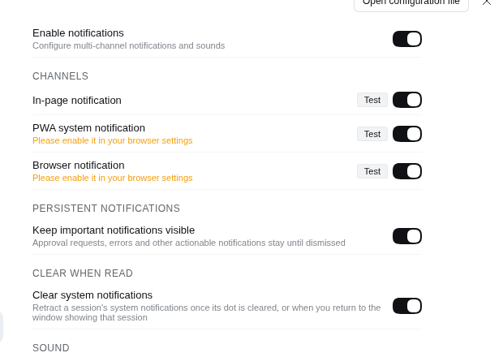

# 已读后清除系统通知 — 验证

日期：2026-10-12

## 1. 引擎行为（已在真实浏览器内执行，通过）

方法：esbuild 把 `src/notification-engine.ts` 打成浏览器 bundle，在 headless Chrome 里用**假 ctx + 假 `Notification`** 驱动**真实引擎代码**（不开 DSH 本体）。`Notification` 替换为记录型替身，`close()` 置 `closed` 并可观察。

| 场景 | 断言 | 结果 |
|------|------|------|
| 完成点消失 | A、B 两个会话各弹 1 条；把 A 的 `completionUnread` 由 true 转 false 后，A 的通知关闭、B 的通知保持 | ✅ A closed=true，B closed=false |
| 待交互点消失 | 会话 C 进入 `pendingInteraction="approval"` 弹通知；点消失后通知关闭 | ✅ 剩余未关闭 0 条 |
| 回到前台 | 通知栏有会话 A 的通知，`current` 为 A；窗口转前台后通知关闭 | ✅ 剩余未关闭 0 条 |
| 开关关闭 | `dismissOnRead=false` 时，同样的点消失流程不动通知 | ✅ 剩余未关闭 1 条 |

无 pageerror、无 console error。

## 2. 线上实例冒烟（已执行，通过）

headless Chrome 打开 `http://127.0.0.1:4180` 实际 GUI：

- `globalThis.__dshNotifyEngine.alive === true` —— 引擎成功构造，说明新增的 `uiSession` 注入在真实环境中解析成功（若注入失败，引擎构造会抛错、通知全挂）。
- 设置 → Notifications 出现新一栏「CLEAR WHEN READ / Clear system notifications」，开关默认打开，描述文案正确。
- 全部 7 个开关均带 `role="switch"` + `aria-checked`；点一下「Clear system notifications」→ `aria-checked=false` 且 `localStorage` 中 `dismissOnRead=false`，再点回来 → 双向一致。
- 无 pageerror、无 console error。

## 3. 需你在真机验收的部分

通知栏的真实行为无法在 headless 环境断言（拿不到系统通知栏），请在手机上验证。前置：**硬刷新**（或重开 PWA）让新 bundle 生效。

1. **设置项出现**：设置 → 通知 → 「已读后清除」，开关默认打开。
2. **未读点消失即撤下**：把 DSH 切到后台（或锁屏），让某个**非当前会话**跑完一轮 → 系统通知出现；回到 DSH，点开该会话（侧边栏那个点消失）→ 通知栏里该会话的通知应随之消失。同一时刻其他会话的通知不受影响。
3. **回前台即撤下**：让**当前正在查看的会话**在后台跑完一轮 → 收到通知；切回 DSH 窗口（不点通知）→ 该通知应自动消失。
4. **授权类通知**：后台收到「需要授权」通知后回前台处理掉该请求 → 通知消失（此类通知是常驻型，此前必须手动划掉）。
5. **关闭开关恢复原状**：把「已读后清除」关掉，重复场景 2 → 通知应一直留在通知栏直到手动划掉。

## 备注

- 清除范围仅系统通知（PWA / 浏览器通知），页面内 toast 行为不变。
- 浏览器通道依赖页面持有的 `Notification` 实例；若系统在通知展示后回收了该实例（如重启浏览器），撤下会失效——这属于既有限制。
- DSH 自带 Service Worker 的 `notificationclick` 本来就会关闭被点击的那一条；本次新增的是**未被点击**时的撤下路径。
